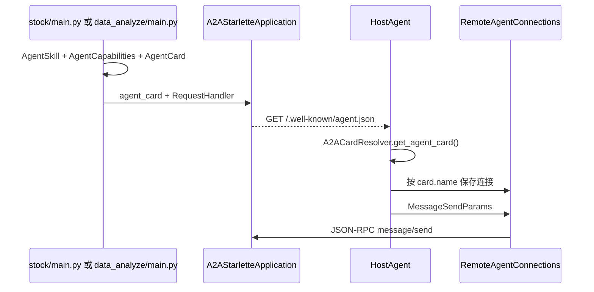
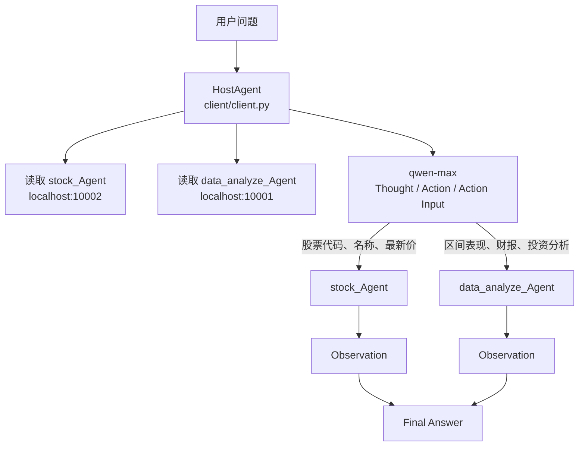
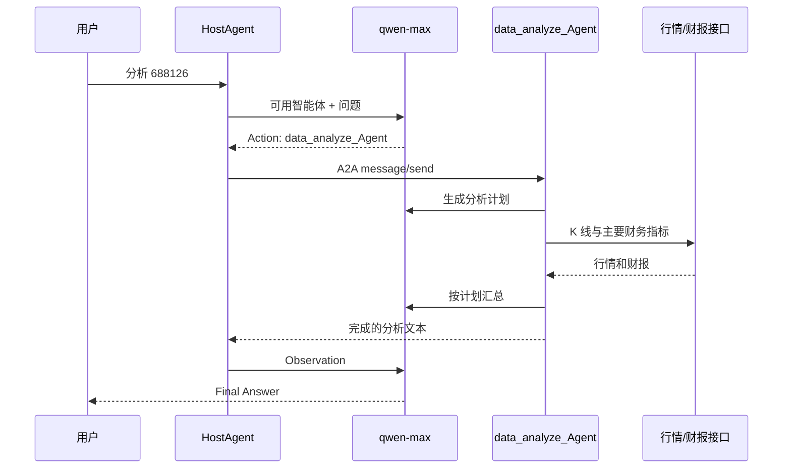

# LangGraph A2A 股票分析示例

一个基于 [A2A](https://github.com/a2aproject/A2A) 和 LangGraph 的多智能体示例。宿主代理负责理解问题并选择远程智能体；股票查询和财务分析分别由两个独立服务完成。

本仓库只演示公开行情与财报数据的获取、编排和汇总，不构成投资建议。

## 目录

```text
LangGraph-a2a/
├── client/                  # 宿主代理，交互入口
│   ├── client.py            # 路由循环、远程调用
│   └── remote_agent_connection.py
├── stock/                   # 股票行情服务，默认 10002
│   ├── main.py              # A2A 服务入口
│   ├── agent.py             # LangGraph：查行情 -> 整理回答
│   ├── agent_executor.py
│   ├── tools.py             # 腾讯行情
│   └── llm.py
└── data_analyze/            # 股价与财报分析服务，默认 10001
    ├── main.py
    ├── agent.py             # LangGraph：计划 -> 工具 -> 报告
    ├── prompt.py
    ├── agent_executor.py
    ├── llm.py
    └── tools/
        ├── market_data.py   # 行情 K 线和财报请求
        ├── stock_price.py   # 区间涨跌、回撤、波动率
        └── financial_report.py
```

## 环境

```powershell
pip install -r requirements.txt
pip install langgraph langchain-core langchain-openai httpx uvicorn click requests numpy pydantic
$env:DASHSCOPE_API_KEY = "你的通义千问密钥"
```

`requirements.txt` 固定了本示例使用的 `a2a-sdk==0.2.4`。模型调用走 DashScope 兼容接口，模型名为 `qwen-max`。不要把密钥写入代码或提交到仓库。

本地 A2A 地址是 `localhost`。如果环境里设置了 `HTTP_PROXY` / `HTTPS_PROXY`，客户端已使用 `trust_env=False` 直连，避免代理把本地请求转成 502。

## 启动

开三个终端，都进入对应目录后运行：

```powershell
# 终端 1：股票查询
cd stock
python main.py --host 127.0.0.1 --port 10002

# 终端 2：股价与财报分析
cd data_analyze
python main.py --host 127.0.0.1 --port 10001

# 终端 3：宿主代理
cd client
python client.py
```

客户端启动后会读取两个服务的 `/.well-known/agent.json`，拿到智能体名称和能力说明。输入 `quit` 退出。

示例问题：

- `300750 的最新价是多少？`：应路由到 `stock_Agent`。
- `分析一下 688126 的股价和财务情况`：应路由到 `data_analyze_Agent`。

## AgentCard 的创建与调用

AgentCard 是远程智能体的名片。服务启动时在代码里创建它，A2A SDK 把它发布成 `/.well-known/agent.json`。宿主代理不写死智能体实现，只根据这张名片知道名称、地址和能力，再用名片里的 `name` 发起调用。



### 服务端如何创建

两个服务的创建方式相同，分别在 [stock/main.py](stock/main.py) 和 [data_analyze/main.py](data_analyze/main.py)。先声明能力和技能，再组装卡片：

```python
capabilities = AgentCapabilities(streaming=False, pushNotifications=True)
skill = AgentSkill(
    id="股票信息",
    name="股票信息查询工具",
    description="可以查询股票的代码，名称，收盘价等信息",
    tags=["股票信息"],
    examples=["300750是哪只股票的代码？"],
)
agent_card = AgentCard(
    name="stock_Agent",          # 客户端 Action 必须使用这个名字
    description="可以查询股票的代码，名称，收盘价等信息",
    url=f"http://{host}:{port}/",  # 远程调用的 JSON-RPC 地址
    version="1.0.0",
    defaultInputModes=StockAgent.SUPPORTED_CONTENT_TYPES,   # text, text/plain
    defaultOutputModes=StockAgent.SUPPORTED_CONTENT_TYPES,
    capabilities=capabilities,
    skills=[skill],
)
```

字段分工：

| 字段 | 作用 |
| --- | --- |
| `name` | 名片主键。客户端用它匹配 `Action: stock_Agent` 或 `Action: data_analyze_Agent`。 |
| `description` | 放进宿主提示词，供模型决定该把问题交给谁。 |
| `url` | 由启动参数 `--host` 和 `--port` 生成，是后续 `message/send` 的目标。 |
| `skills` | 技能说明和示例问题。当前客户端路由只用 `name` 与 `description`，技能示例不会自动进入提示词。 |
| `capabilities.streaming` | 两个服务都是 `False`，所以客户端走非流式 `send_message`，而不是 `send_message_streaming`。 |
| `defaultInputModes` / `defaultOutputModes` | 来自各 Agent 类的 `SUPPORTED_CONTENT_TYPES`，当前为 `text` 和 `text/plain`。 |

卡片本身不执行业务。它和真正的执行器一起交给服务器：

```python
request_handler = DefaultRequestHandler(
    agent_executor=StockAgentExecutor(),  # 分析服务则是 DataAnalyzeAgentExecutor
    task_store=InMemoryTaskStore(),
    push_notifier=InMemoryPushNotifier(httpx_client),
)
server = A2AStarletteApplication(
    agent_card=agent_card,
    http_handler=request_handler,
)
uvicorn.run(server.build(), host=host, port=port)
```

因此新增一个远程智能体时，要同时做两件事：在对应 `main.py` 中创建新的 `AgentCard`，并把它的 `url` 加到客户端的 `remote_agent_addresses`。

### 客户端如何发现和调用

[client/client.py](client/client.py) 启动时遍历这两个地址：

```python
remote_agent_addresses = [
    "http://localhost:10002",
    "http://localhost:10001",
]
```

`connect_to_server()` 对每个地址创建 `A2ACardResolver`，调用 `get_agent_card()` 拉取名片，再按 `card.name` 建立连接：

```python
card_resolver = A2ACardResolver(httpx_client=self.httpx_client, base_url=address)
card = await card_resolver.get_agent_card()
self.remote_agent_connections[card.name] = RemoteAgentConnections(self.httpx_client, card)
self.cards[card.name] = card
```

`list_remote_agents()` 只把 `{name, description}` 写进路由提示词。模型输出 `Action` 后，`send_message()` 用这个名字找回连接，并组装 A2A 消息：

```python
request = MessageSendParams(
    id=str(uuid.uuid4()),
    message=Message(
        role="user",
        parts=[TextPart(text=message)],
        messageId=messageId,
    ),
    configuration=MessageSendConfiguration(
        acceptedOutputModes=["text", "text/plain", "image/png"],
    ),
)
response = await client.send_message(request, self.task_callback)
```

[client/remote_agent_connection.py](client/remote_agent_connection.py) 用名片构造 `A2AClient`。因为本项目的 `streaming` 为 `False`，实际发送的是：

```python
response = await self.agent_client.send_message(
    SendMessageRequest(id=str(uuid4()), params=request)
)
```

返回若是 `Task`，客户端读取 `artifacts` 里的文本；若是 `Message`，读取第一个 part 的文本。这段文本成为下一轮模型输入中的 `Observation`。名片上的 `name` 写错或服务未启动时，`Action` 无法命中 `remote_agent_connections`，调用会直接失败。

## 总体流程



宿主代理不直接查行情。它把远程智能体卡片放进提示词，让模型输出：

```text
Thought: ...
Action: stock_Agent
Action Input: 688126
PAUSE
```

客户端用正则取出 `Action` 和 `Action Input`，通过 A2A 的 `message/send` 发给对应服务，再把返回文本作为 `Observation` 送回模型，直到出现 `Final Answer`。

问候或告别按提示词规则直接回答，不调用远程智能体。远程结果为空时返回明确错误，不再对空列表取下标。

## 股票查询服务

`stock/main.py` 在 10002 端口发布名为 `stock_Agent` 的 A2A 服务。请求进入 `StockAgentExecutor`，再调用 LangGraph。


`get_stock_info` 把 6 位代码转成腾讯行情代码：`6/9` 为沪市，`4/8` 为北交所，其余为深市。请求 `qt.gtimg.cn` 时关闭环境代理，并按 GBK 解码。返回名称、最新价、昨收、今开、涨跌额和涨跌幅。

模型随后用 `ResponseFormat` 给出 `completed`、`input_required` 或 `error`。执行器据此结束任务、要求补充输入，或返回错误文本。

## 数据分析服务

`data_analyze/main.py` 在 10001 端口发布 `data_analyze_Agent`。它先生成计划，再按计划调用工具，最后整理成报告。


计划节点只根据 `prompt.py` 中声明的两个工具设计步骤，不访问不存在的本地 CSV。

工具返回的是文本摘要：

| 工具 | 数据来源 | 内容 |
| --- | --- | --- |
| `analyze_stocks` | 腾讯前复权日 K，`web.ifzq.gtimg.cn` | 最近约 250 个交易日的起止价、区间涨跌幅、最大回撤、年化波动率 |
| `get_financial_report` | 东方财富主要指标，`ZYZBAjaxNew` | 报告期、营收及同比、归母净利润及同比、ROE、毛利率、净利率、资产负债率、每股收益、每股净资产 |

`respond` 去掉末尾的 `Final Answer` 标记，把剩余文本写入 `ResponseFormat(status="completed")`。A2A 执行器再把它作为任务产物返回给宿主代理。

## 一次分析请求



同一条会话用 A2A 的 `contextId` 作为 LangGraph `thread_id`，检查点保存在进程内的 `MemorySaver`。服务重启后记忆不会保留。
