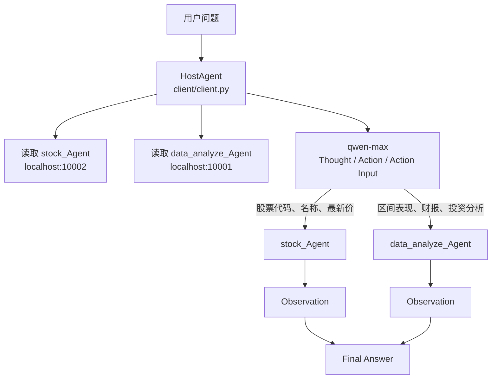
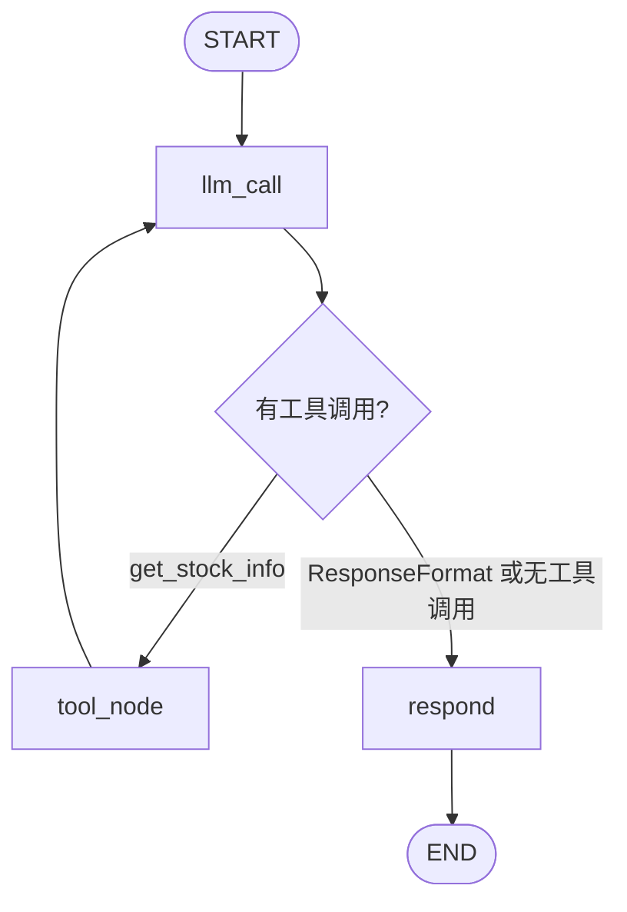
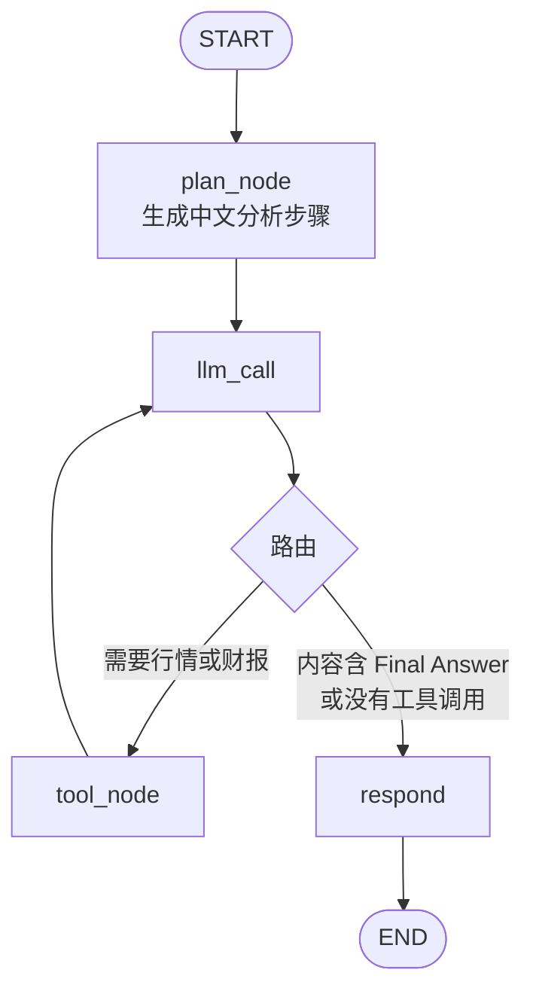
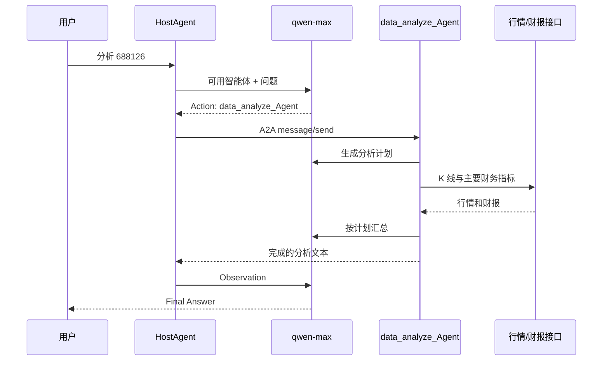

# LangGraph A2A 股票分析示例

一个基于 [A2A](https://github.com/a2aproject/A2A) 和 LangGraph 的多智能体示例。宿主代理负责理解问题并选择远程智能体；股票查询和财务分析分别由两个独立服务完成。

本仓库只演示公开行情与财报数据的获取、编排和汇总，不构成投资建议。

## 目录

```text
LangGraph-a2a/
├── client/                  # 宿主代理，交互入口
│   ├── client.py            # 路由循环、远程调用
│   └── remote_agent_connection.py
├── stock/                   # 股票行情服务，默认 10002
│   ├── main.py              # A2A 服务入口
│   ├── agent.py             # LangGraph：查行情 -> 整理回答
│   ├── agent_executor.py
│   ├── tools.py             # 腾讯行情
│   └── llm.py
└── data_analyze/            # 股价与财报分析服务，默认 10001
    ├── main.py
    ├── agent.py             # LangGraph：计划 -> 工具 -> 报告
    ├── prompt.py
    ├── agent_executor.py
    ├── llm.py
    └── tools/
        ├── market_data.py   # 行情 K 线和财报请求
        ├── stock_price.py   # 区间涨跌、回撤、波动率
        └── financial_report.py
```

## 环境

```powershell
pip install -r requirements.txt
pip install langgraph langchain-core langchain-openai httpx uvicorn click requests numpy pydantic
$env:DASHSCOPE_API_KEY = "你的通义千问密钥"
```

`requirements.txt` 固定了本示例使用的 `a2a-sdk==0.2.4`。模型调用走 DashScope 兼容接口，模型名为 `qwen-max`。不要把密钥写入代码或提交到仓库。

本地 A2A 地址是 `localhost`。如果环境里设置了 `HTTP_PROXY` / `HTTPS_PROXY`，客户端已使用 `trust_env=False` 直连，避免代理把本地请求转成 502。

## 启动

开三个终端，都进入对应目录后运行：

```powershell
# 终端 1：股票查询
cd stock
python main.py --host 127.0.0.1 --port 10002

# 终端 2：股价与财报分析
cd data_analyze
python main.py --host 127.0.0.1 --port 10001

# 终端 3：宿主代理
cd client
python client.py
```

客户端启动后会读取两个服务的 `/.well-known/agent.json`，拿到智能体名称和能力说明。输入 `quit` 退出。

示例问题：

- `300750 的最新价是多少？`：应路由到 `stock_Agent`。
- `分析一下 688126 的股价和财务情况`：应路由到 `data_analyze_Agent`。

## 总体流程



宿主代理不直接查行情。它把远程智能体卡片放进提示词，让模型输出：

```text
Thought: ...
Action: stock_Agent
Action Input: 688126
PAUSE
```

客户端用正则取出 `Action` 和 `Action Input`，通过 A2A 的 `message/send` 发给对应服务，再把返回文本作为 `Observation` 送回模型，直到出现 `Final Answer`。

问候或告别按提示词规则直接回答，不调用远程智能体。远程结果为空时返回明确错误，不再对空列表取下标。

## 股票查询服务

`stock/main.py` 在 10002 端口发布名为 `stock_Agent` 的 A2A 服务。请求进入 `StockAgentExecutor`，再调用 LangGraph。



`get_stock_info` 把 6 位代码转成腾讯行情代码：`6/9` 为沪市，`4/8` 为北交所，其余为深市。请求 `qt.gtimg.cn` 时关闭环境代理，并按 GBK 解码。返回名称、最新价、昨收、今开、涨跌额和涨跌幅。

模型随后用 `ResponseFormat` 给出 `completed`、`input_required` 或 `error`。执行器据此结束任务、要求补充输入，或返回错误文本。

## 数据分析服务

`data_analyze/main.py` 在 10001 端口发布 `data_analyze_Agent`。它先生成计划，再按计划调用工具，最后整理成报告。



计划节点只根据 `prompt.py` 中声明的两个工具设计步骤，不访问不存在的本地 CSV。

工具返回的是文本摘要：

| 工具 | 数据来源 | 内容 |
| --- | --- | --- |
| `analyze_stocks` | 腾讯前复权日 K，`web.ifzq.gtimg.cn` | 最近约 250 个交易日的起止价、区间涨跌幅、最大回撤、年化波动率 |
| `get_financial_report` | 东方财富主要指标，`ZYZBAjaxNew` | 报告期、营收及同比、归母净利润及同比、ROE、毛利率、净利率、资产负债率、每股收益、每股净资产 |

`respond` 去掉末尾的 `Final Answer` 标记，把剩余文本写入 `ResponseFormat(status="completed")`。A2A 执行器再把它作为任务产物返回给宿主代理。

## 一次分析请求



同一条会话用 A2A 的 `contextId` 作为 LangGraph `thread_id`，检查点保存在进程内的 `MemorySaver`。服务重启后记忆不会保留。
